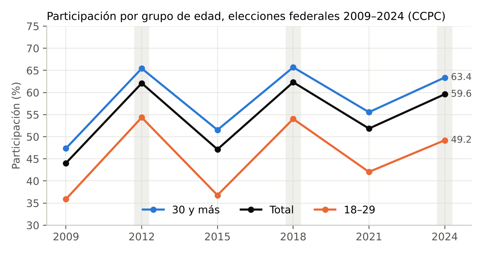
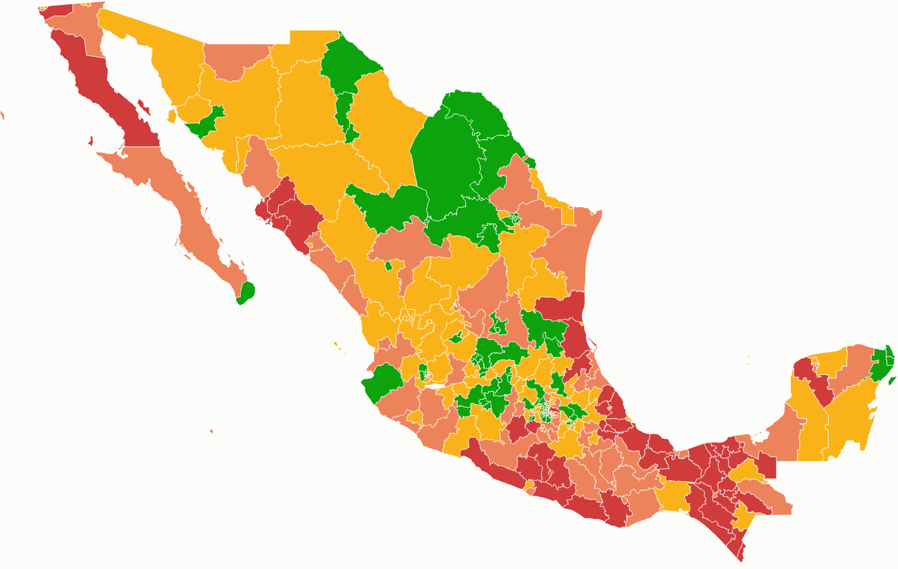
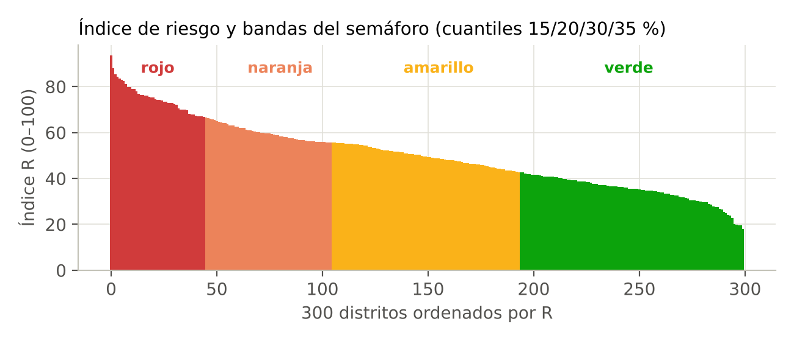
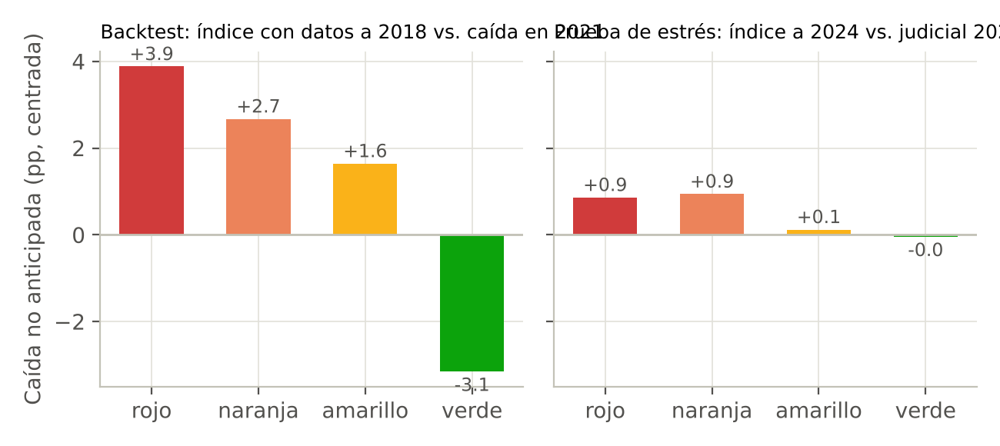
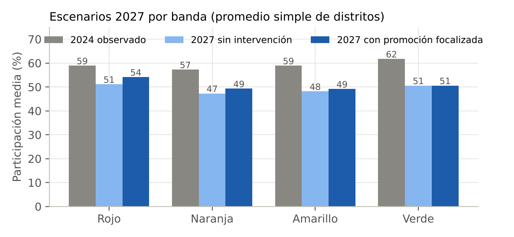

# Resumen ejecutivo

La abstención no es un evento: es un proceso que deja rastro en los datos antes de ocurrir. Este proyecto construye, con la Plataforma de Conteos Censales de Participación Ciudadana (CCPC) como única fuente, un índice de riesgo de caída de la participación para cada uno de los 300 distritos electorales federales, lo traduce a un semáforo territorial y propone, para cada banda y para cada mecanismo dominante, acciones preventivas alineadas con la Estrategia Nacional de Cultura Cívica.

La tesis es que la abstención es la expresión territorial y medible de dos déficits que la literatura y las encuestas del propio INE han documentado: el de confianza en las instituciones y el de comprensión de lo que está en juego en cada elección. Ambos déficits operan a través de tres mecanismos observables en los conteos censales: la pérdida del hábito de votar en las cohortes jóvenes, la desafección reciente del electorado adulto y la vulnerabilidad estructural del territorio. El índice mide los tres con nueve indicadores, los normaliza y los agrega siguiendo el *Handbook on Constructing Composite Indicators* de la OCDE y el Centro Común de Investigación de la Comisión Europea, y declara cada juicio de valor (pesos, cortes, supuestos) en un archivo de configuración público.

Los resultados principales son cuatro. Primero, 45 distritos quedan en rojo y 60 en naranja; concentran 33.4 millones de personas en lista nominal. El rojo se agrupa en Veracruz (13 distritos), Chiapas (9), Tabasco (6), Guerrero (5) y Sinaloa (3); el Estado de México aporta 3 rojos y 8 naranjas por desgaste juvenil, y el norte urbano (Nuevo León, Jalisco, Sonora) muestra las caídas más pronunciadas de la participación 18–29 aunque no siempre llega al rojo. Segundo, el mecanismo dominante en el rojo es la desafección reciente (37 de 45 distritos), no la vulnerabilidad estructural: el riesgo no se explica por pobreza o ruralidad, sino por un electorado que votaba y dejó de hacerlo. Tercero, el índice anticipa: calculado sólo con información hasta 2018, ordena correctamente la caída no anticipada de la elección intermedia de 2021 (correlación de Spearman de 0.37, orden monótono por banda; 76 % de los distritos rojos cayeron más que la mediana, frente a 28 % de los verdes). Cuarto, el índice no anticipa la participación de la elección judicial de 2025, y lo reportamos como límite explícito: ese evento respondió a una elección inédita y a la capacidad de movilización organizada, no al proceso de erosión que el índice mide.

Los escenarios para la elección intermedia de 2027 muestran una participación nacional de 49.2 % si cada distrito sigue su impulso reciente y de 50.3 % si el INE concentra una campaña de promoción en los distritos rojos, naranjas y amarillos, y esta rinde 3, 2 y 1 puntos respectivamente. Esos rendimientos son un supuesto declarado, no un resultado medido. Con ellos, la diferencia equivale a algo más de un millón de personas. Todo el pipeline es reproducible con tres scripts de Python, corre en minutos sobre los archivos abiertos del INE y no utiliza ningún dato personal.

# 1. El problema y la tesis

La convocatoria plantea una pregunta precisa: ¿qué zonas podrían presentar mayor abstención si no se interviene? Responderla con la participación absoluta es un error metodológico, porque la participación absoluta refleja sobre todo la estructura socioeconómica de cada territorio y castiga de manera permanente a los distritos pobres sin decir nada sobre lo que puede prevenirse. Lo que puede prevenirse es la caída respecto a la trayectoria propia de cada distrito: la diferencia entre lo que ese distrito hacía y lo que está dejando de hacer. Esa es la variable que el índice construye y la que el semáforo comunica.

La segunda decisión de diseño es teórica. La abstención se ha explicado desde el cálculo racional del voto (Downs, 1957; Riker y Ordeshook, 1968), desde los recursos y la posición social (Verba, Schlozman y Brady, 1995), desde la movilización de partidos y organizaciones (Rosenstone y Hansen, 1993) y desde la formación del hábito en la juventud (Plutzer, 2002; Gerber, Green y Shachar, 2003; Franklin, 2004). Para una elección intermedia pesa además la teoría de las elecciones de segundo orden (Reif y Schmitt, 1980): la participación cae porque el electorado percibe que hay menos en juego. Estas explicaciones no compiten; operan sobre dos déficits que la evidencia mexicana documenta con claridad. El *Informe País 2020* (INE y PNUD, 2022) registra que la confianza en los partidos es de 22 % y que casi dos de cada tres personas consideran que les da lo mismo un régimen democrático que uno autoritario; la Encuesta Nacional de Cultura Cívica (INEGI, INE y Segob, 2021) muestra el bajo conocimiento sobre qué se elige y qué hace cada cargo. El primero es un déficit de confianza (en los términos de Easton, 1975, una erosión del apoyo difuso); el segundo, un déficit de comprensión (Delli Carpini y Keeter, 1996). La abstención es la forma en que ambos se vuelven visibles en el territorio.

De ahí se sigue que el índice no se construye como una analogía del cumplimiento regulatorio ni como un modelo de securitización de la abstención. Toma de la gestión de riesgos sólo su gramática (identificar, medir, clasificar, priorizar, monitorear) y de la disciplina de inteligencia la lógica de indicadores y alertas (Grabo, 2004): un sistema de señales adelantadas, umbrales explícitos y acciones asociadas a cada nivel de alerta. El mandato institucional para hacerlo es directo: el artículo 41 constitucional y los artículos 30 y 58 de la Ley General de Instituciones y Procedimientos Electorales asignan al INE la promoción del voto y la educación cívica, y la ENCCÍVICA 2017–2023 (INE, 2016) organiza esa tarea en los ejes de Verdad, Diálogo y Exigencia, con un sistema de monitoreo que pide precisamente instrumentos de focalización territorial como este.

# 2. Datos: qué se usó y cómo se trató

## 2.1 La fuente

La fuente única es la Plataforma de Conteos Censales de Participación Ciudadana de la DECEyEC, en sus archivos de datos abiertos para las elecciones federales de 2009, 2012, 2015, 2018, 2021 y 2024, más el archivo del Proceso Electoral Extraordinario del Poder Judicial de la Federación 2024–2025. Cada archivo registra, por sección electoral, sexo y año de edad cumplido, cuántas personas estaban en la lista nominal de los cuadernillos (LN), cuántas tienen marca de voto (SV), cuántas no la tienen (NV) y cuántas quedaron sin especificar (NS). La participación se calcula, como lo hace el propio INE, como SV / (SV + NV). Los archivos suman 3.9 gigabytes y 26.6 millones de registros; ninguno contiene datos personales, pues la unidad mínima es el agregado sección–sexo–edad.

La cifra nacional que arroja la fuente reproduce las oficiales: 44.1 % en 2009, 62.1 % en 2012, 47.1 % en 2015, 62.4 % en 2018, 51.8 % en 2021, 59.7 % en 2024 y 13.0 % en 2025. La figura 1 muestra la serie por grupo de edad: la brecha entre la población de 18 a 29 años y la de 30 y más se ha mantenido alrededor de catorce puntos en todo el periodo, y la participación juvenil en 2024 (49.2 %) fue cinco puntos menor que en 2012 (54.4 %).

## 2.2 Agregación y redistritación

Los datos se agregaron a distrito electoral federal, sexo, grupo de edad (18–19, 20–24, 25–29, 30–39, 40–49, 50–59, 60–69 y 70 y más) y tipo de sección (urbana, mixta, rural). El problema que debe resolver cualquier serie 2009–2024 es que los archivos de 2009 a 2021 refieren el distrito al marco cartográfico de 2021 (la distritación de 2017) y los de 2024 y 2025 al marco de 2023 (la distritación vigente). Para que los 300 distritos sean comparables en el tiempo se construyó una tabla de equivalencias sección–distrito 2023 y con ella se reasignaron todas las secciones de 2009–2021 a su distrito vigente. La tabla toma la cartografía seccional histórica sistematizada por Magar (2019, actualización 2026) a partir de los catálogos del INE: 74 002 secciones se asignan de forma directa; 1 076 secciones que fueron divididas en 2022–2023 heredan el distrito de sus secciones hijas; y 851 secciones residuales se asignan por mayoría del distrito al que fue su distrito anterior. La lista nominal que no pudo asignarse es de 0.085 % en 2009, 0.077 % en 2012, 0.004 % en 2021 y cero en los demás años. La tabla de equivalencias y el script que la aplica forman parte del repositorio.

## 2.3 Qué no contiene la fuente

Los archivos abiertos no incluyen la marca de población indígena o afromexicana que sí ofrece el visualizador de la plataforma. Por eso el componente de vulnerabilidad se construye con las variables que los archivos sí traen (tipo de sección, sexo y estructura de edad), y la dimensión étnica queda señalada como extensión inmediata si el INE libera esa variable en los datos abiertos. Tampoco se incorporan variables externas (marginación, violencia, conectividad), por decisión de diseño: la convocatoria pide un instrumento construido sobre el CCPC y el valor del índice está en demostrar cuánto se puede anticipar con la información que el propio Instituto ya produce.

# 3. Método: un índice compuesto con juicios de valor declarados

El índice sigue los diez pasos del *Handbook on Constructing Composite Indicators* (OECD y JRC, 2008): marco teórico, selección de indicadores, imputación, análisis multivariado, normalización, ponderación y agregación, análisis de sensibilidad, regreso a los datos, vínculo con otras variables y visualización. El Handbook advierte que lo mal definido se mide mal (p. 22) y que un índice compuesto puede enviar mensajes engañosos si está mal construido (p. 13); la respuesta a esa advertencia es que cada decisión queda escrita, justificada y abierta a prueba.

## 3.1 Los tres componentes y los nueve indicadores

Para cada distrito *d* y elección *t* se calculan la participación total *p*, la de 18 a 29 años *p~J~*, la de 30 y más *p~A~*, la de mujeres *p~M~* y la de hombres *p~H~*, la participación del grupo 30–39 y la composición de la lista nominal por tipo de sección y edad. Con esas series se construyen nueve indicadores, todos orientados de modo que un valor mayor significa más riesgo.

| Componente | Indicador | Definición | Fundamento |
|---|---|---|---|
| **A. Hábito** (0.40) | A1 Desgaste juvenil | Pendiente negativa de *p~J~* en la regresión *p~J~ = a + β·t + γ·P + e* sobre 2009–2024, donde *P* indica elección presidencial | Plutzer (2002); Franklin (2004): el hábito se forma o se pierde en las primeras elecciones |
| | A2 Brecha generacional | (*p~A~* − *p~J~*)~2024~ − (*p~A~* − *p~J~*)~2012~ | Si la brecha crece, la cohorte joven se desacopla del resto |
| | A3 Retención de cohorte | mediana(*r*) − *r*, con *r* = *p*~30–39, 2024~ − *p~J~*~, 2012~ | Ryder (1965): la cohorte que debutó en 2012 debería votar más doce años después; si no, el hábito no cuajó |
| **B. Desafección** (0.40) | B1 Rebote perdido | (*p*~2012~ − *p*~2009~) − (*p*~2024~ − *p*~2021~) | Reif y Schmitt (1980): un rebote presidencial débil señala que la elección «grande» ya no moviliza como antes |
| | B2 Caída adulta | *p~A~*~,2018~ − *p~A~*~,2024~ | Easton (1975); Norris (1999): quien ya votaba y deja de hacerlo expresa pérdida de apoyo difuso |
| | B3 Volatilidad | Desviación estándar de los residuos de *p = a + b·t + c·P + e* | Rosenstone y Hansen (1993): participación que depende de la movilización coyuntural es frágil |
| **C. Vulnerabilidad** (0.20) | C1 Peso rural y mixto | Porcentaje de la lista nominal 2024 en secciones rurales y mixtas | Verba, Schlozman y Brady (1995): costos de acceso |
| | C2 Brecha de género | \|*p~M~* − *p~H~*\| en 2024 | Desigualdad persistente en la participación |
| | C3 Peso juvenil | Porcentaje de la lista nominal 2024 con 18 a 29 años | Exposición: cuántas personas están en la edad en que el hábito se decide |

Los pesos dentro de cada componente son 0.30, 0.30 y 0.40 en A (la retención de cohorte es la medida más directa del hábito); 0.45, 0.35 y 0.20 en B (el rebote perdido es la señal más limpia de desafección porque compara el distrito consigo mismo en dos ciclos completos); y 0.40, 0.35 y 0.25 en C.

## 3.2 Normalización, agregación y bandas

Cada indicador se convierte a percentil entre los 300 distritos (0 a 100), el método que el Handbook recomienda cuando hay valores extremos y cuando lo que importa es la posición relativa (pp. 28–30). Las alternativas min–max y *z* se calculan en el análisis de sensibilidad. Los componentes se agregan de forma lineal y el índice final es

> **R = 0.40·A + 0.40·B + 0.20·C**

El Handbook es explícito en que los pesos son juicios de valor y no verdades estadísticas (p. 31); los nuestros expresan que el riesgo prevenible está en los procesos (hábito y desafección) más que en la estructura (vulnerabilidad), que el INE no puede cambiar en un ciclo electoral. Las bandas del semáforo se fijan por cuantiles del índice: el 15 % de distritos con mayor R es rojo, el 20 % siguiente naranja, el 30 % siguiente amarillo y el 35 % restante verde. Los cuantiles se eligieron porque la capacidad operativa de las juntas distritales es finita y el instrumento debe producir una lista de atención de tamaño manejable, no porque exista un umbral natural en los datos.

Dos resultados acompañan a la banda. El **mecanismo dominante** es el componente que aporta al menos 40 % del valor de R (hábito, desafección o vulnerabilidad); si ninguno lo alcanza, el distrito se clasifica como mixto. Esta etiqueta es la que conecta el diagnóstico con la acción: un rojo por hábito y un rojo por desafección requieren intervenciones distintas. La **prioridad** multiplica R por el tamaño relativo de la lista nominal del distrito, de modo que entre dos distritos con el mismo riesgo se atiende primero al que tiene más personas en juego.

## 3.3 Ejemplo

El distrito 18 de Veracruz tiene el índice más alto del país (R = 93.5). Su participación total fue de 69.6 % en 2012, 68.4 % en 2018 y 67.7 % en 2021, y cayó a 57.3 % en 2024: entre 2009 y 2012 había subido 17 puntos de la intermedia a la presidencial, y entre 2021 y 2024 bajó 10. La participación de 18 a 29 años es de 41.3 %. Sus componentes son A = 92, B = 97 y C = 91: los tres son altos, pero la desafección aporta 41 % de R y queda como mecanismo dominante. Con 305 266 personas en lista nominal ocupa el primer lugar de prioridad nacional.

# 4. Resultados

## 4.1 El semáforo

El mapa (figura 2) muestra un patrón nítido. El rojo se concentra en el Golfo y el sureste: Veracruz (13 de sus 19 distritos), Chiapas (9 de 13), Tabasco (6 de 6), Guerrero (5 de 8) y, en el Pacífico norte, Sinaloa (3 de 7). Oaxaca aparece sobre todo en naranja (7 de 10). El Estado de México reparte sus 40 distritos entre las cuatro bandas (3 rojos, 8 naranjas, 15 amarillos y 14 verdes). La Ciudad de México, Coahuila y Chihuahua quedan en verde: no porque participen mucho en términos absolutos, sino porque su trayectoria es estable y su cohorte joven no se ha desprendido.

| Banda | Distritos | Lista nominal 2024 | Participación 2012 | 2018 | 2021 | 2024 | 18–29 en 2024 |
|---|---|---|---|---|---|---|---|
| Rojo | 45 | 14.4 M | 66.0 % | 66.4 % | 58.6 % | 58.9 % | 45.6 % |
| Naranja | 60 | 19.0 M | 61.5 % | 62.1 % | 52.1 % | 57.3 % | 46.0 % |
| Amarillo | 89 | 28.9 M | 61.3 % | 61.3 % | 50.6 % | 58.9 % | 48.8 % |
| Verde | 106 | 36.1 M | 61.3 % | 61.3 % | 50.1 % | 61.7 % | 52.6 % |

La tabla resume por qué el índice no es un mapa de la participación baja. Los distritos rojos participaban en 2012 y 2018 *más* que el resto del país (66 %); en 2024 están siete puntos por debajo de su propio nivel y cuatro por debajo de los verdes. Son los distritos que están perdiendo electorado, no los que nunca lo tuvieron. La figura 3 muestra la distribución del índice: una pendiente continua, sin saltos, que confirma que los cortes son operativos y no naturales.

## 4.2 El mecanismo

| Banda | Desafección | Hábito | Mixto | Vulnerabilidad |
|---|---|---|---|---|
| Rojo | 37 | 8 | 0 | 0 |
| Naranja | 31 | 28 | 1 | 0 |
| Amarillo | 39 | 49 | 1 | 0 |
| Verde | 45 | 47 | 9 | 5 |

En el rojo, 37 de 45 distritos tienen a la desafección como mecanismo dominante: la caída es reciente, afecta al electorado adulto y coincide con un rebote presidencial débil. El hábito domina en los 8 rojos restantes y en casi la mitad de los naranjas y amarillos; es el mecanismo de los distritos urbanos y metropolitanos del Estado de México, Nuevo León, Jalisco y Sonora, donde la participación de 18 a 29 años ha caído entre 13 y 20 puntos desde 2012 (el distrito 13 de Nuevo León pasó de 61.5 % a 41.8 %). La vulnerabilidad estructural sólo domina en cinco distritos, todos verdes: cuando un territorio es rural y pobre pero su participación es estable, el índice no lo marca, y eso es deliberado.

## 4.3 La lista de prioridad

Los quince primeros lugares de prioridad nacional son los distritos 18, 19, 7 y 8 de Veracruz; 5 y 2 de Tabasco; 13, 11 y 7 de Chiapas; 3 de Sinaloa; 6 de Tamaulipas; 35 y 36 del Estado de México; y 6 y 8 de Guerrero. La lista completa, con los nueve indicadores, los tres componentes, el mecanismo y las series de participación, está en el archivo CSV y en el tablero.

# 5. ¿Funciona? Validación fuera de muestra

Un índice de riesgo sólo vale si anticipa. Se realizaron dos pruebas, ambas con la misma lógica: la caída que importa es la que la trayectoria propia del distrito no predecía. Para cada distrito se estima el modelo *p = a + b·t + c·P* únicamente con las elecciones previas al año de prueba, se proyecta la participación esperada para ese año y se calcula la sorpresa como la diferencia entre lo esperado y lo observado, centrada en la mediana nacional para separar el choque común de la caída relativa del distrito.

**Backtest 2018 → 2021.** El índice se recalculó usando sólo información hasta 2018 (cuatro elecciones) y se contrastó con la intermedia de 2021, el tipo de elección que el instrumento debe anticipar en 2027. La correlación de Spearman entre R y la sorpresa es de 0.37. La caída no anticipada media es de +3.9 puntos en los distritos rojos, +2.7 en naranjas, +1.6 en amarillos y −3.2 en verdes: el orden es monótono. El 75.6 % de los rojos cayó más que la mediana nacional; sólo el 28.3 % de los verdes. Por componente, la desafección es la que más anticipa (ρ = 0.50), seguida de la vulnerabilidad (0.14); el hábito, medido con sólo cuatro puntos en el tiempo, no aporta en esa prueba (0.01), aunque con la serie completa a 2024 su medición es más estable.

**Prueba de estrés: elección judicial 2025.** Con el índice completo (hasta 2024), la correlación con la sorpresa de 2025 es de 0.04. El semáforo no anticipa ese evento. La explicación es sustantiva y la hacemos explícita: la participación de 13 % en una elección inédita, sin partidos en la boleta y con una oferta que la mayoría del electorado no conocía, respondió a la capacidad de movilización organizada en cada territorio (los distritos del sur, que el índice marca en rojo por su desafección reciente, fueron los que más participaron en 2025 respecto a lo esperado). El índice mide erosión del hábito y del apoyo difuso, no capacidad de movilización; 2025 midió lo segundo. La prueba delimita el alcance del instrumento: es válido para elecciones federales ordinarias y no debe usarse para elecciones extraordinarias de naturaleza distinta.

# 6. Sensibilidad

El Handbook exige probar que los resultados no dependen de decisiones arbitrarias (pp. 34 y 117). Se recalculó el índice bajo diez variantes y se midió qué porcentaje de distritos cambia de banda y qué porcentaje de los rojos se mantiene en rojo.

| Variante | Cambian de banda | Rojos que se mantienen | ρ con el índice base |
|---|---|---|---|
| Peso de A ± 0.10 | 9.3 % / 12.7 % | 95.6 % / 93.3 % | 0.99 |
| Peso de B ± 0.10 | 9.3 % / 12.7 % | 95.6 % / 95.6 % | 0.99 |
| Peso de C ± 0.10 | 13.3 % / 10.7 % | 93.3 % / 93.3 % | 0.99 |
| Pesos iguales en todo | 24.7 % | 84.4 % | 0.96 |
| Normalización min–max | 14.0 % | 86.7 % | 0.98 |
| Normalización *z* | 10.7 % | 91.1 % | 0.99 |
| Agregación geométrica | 24.7 % | 86.7 % | 0.91 |

El criterio de estabilidad que fijamos de antemano (menos de 15 % de distritos cambian de banda ante ±0.10 en los pesos de componente) se cumple en los seis casos. Las variantes estructurales (pesos iguales y agregación geométrica) mueven más la parte media de la distribución, pero el conjunto de distritos rojos se conserva en más de 84 % de los casos en todas las variantes. La lista de atención prioritaria es, por tanto, robusta a las decisiones de diseño; la frontera entre amarillo y verde es la más sensible, y así debe leerse.

# 7. Escenarios para 2027

**Sin intervención.** Cada distrito parte de su participación en la última intermedia (2021) y se le aplica el cambio que tuvo entre las dos últimas presidenciales (2018 → 2024), es decir, su impulso reciente de ciclo a ciclo. El resultado nacional es 49.2 %, por debajo del 51.8 % de 2021. Por banda, los distritos rojos pasarían de 58.6 % a 51.1 %; los naranjas, de 52.1 % a 47.3 %; los amarillos, de 50.6 % a 48.2 %; los verdes se mantendrían en 50.6 %.

**Con intervención.** El escenario supone que el INE concentra una campaña de promoción del voto en los distritos rojos, naranjas y amarillos. La banda no produce participación: sólo decide dónde se concentra la campaña. Se supone que cada distrito intervenido gana 3 puntos si es rojo, 2 si es naranja y 1 si es amarillo; en los verdes no se interviene. Esos valores son un supuesto del equipo. La literatura experimental (Gerber y Green) documenta efectos de varios puntos con contacto personal y casi nulos con contacto impersonal. El equipo no cuenta con una estimación propia de que el efecto crezca con el riesgo. El supuesto se declara en el archivo de configuración y puede ajustarse. El resultado nacional es 50.3 %. La diferencia con el escenario sin intervención, 1.1 puntos, equivale a algo más de un millón de personas; en los distritos rojos son tres puntos, unas 430 mil personas. Con un efecto parejo de 2 puntos en las tres bandas, el resultado sería 50.5 %: la escalera no aumenta el total, sólo reparte la ganancia hacia los rojos.

El escenario no es un pronóstico. Da el orden de magnitud de lo que se podría recuperar con una campaña focalizada, si rinde lo supuesto. La razón para priorizar los distritos rojos no sale de este escenario: sale del índice y de su validación (backtest 2021, correlación de 0.37 con orden monótono por banda).

# 8. Recomendaciones preventivas

Las recomendaciones se formulan por banda y por mecanismo, porque el mismo color exige acciones diferentes según la causa. Todas caben en los ejes de la ENCCÍVICA y en las atribuciones de la DECEyEC y de las juntas distritales.

**Rojo y naranja por desafección** (68 distritos, Golfo, sureste y Sinaloa). La señal es un electorado adulto que votaba y dejó de hacerlo. La acción pertenece a los ejes de Diálogo y Exigencia: diálogos distritales convocados por la Junta con organizaciones locales, universidades y medios comunitarios sobre qué se decide en la intermedia y qué pasó con los resultados anteriores; explicación pública y en lenguaje llano del proceso (quién cuenta, cómo se vigila, qué puede hacer la ciudadanía); y presencia visible del INE en el territorio con anticipación, no sólo en la jornada. El indicador que debe moverse es B2: la participación de 30 años y más.

**Rojo y naranja por hábito** (36 distritos, metrópolis del centro y del norte). La señal es la cohorte de 18 a 29 años que no está adquiriendo el hábito. La acción pertenece al eje de Verdad y a la formación de primovotantes: brigadas de credencialización y de información en planteles de educación media superior y superior, módulos itinerantes en zonas de alta concentración juvenil, mensajes que expliquen qué se elige en 2027 y qué consecuencias tiene, y seguimiento específico de la participación de quienes votarán por primera vez. El indicador que debe moverse es la participación 18–29 y, a mediano plazo, la retención de cohorte.

**Amarillo.** Mantener la oferta ordinaria y aplicar la acción que corresponda al mecanismo dominante con menor intensidad; su función principal en el semáforo es la de vigilancia, porque es la banda desde la que se asciende al naranja.

**Verde.** No requiere acciones extraordinarias. Cinco distritos verdes con vulnerabilidad estructural dominante merecen atención logística (ubicación y accesibilidad de casillas, materiales en lenguas indígenas), pero no de promoción.

**Para el INE como sistema.** Tres recomendaciones institucionales se desprenden del ejercicio. La primera es incorporar el índice al Sistema de Monitoreo, Seguimiento y Evaluación de la ENCCÍVICA como criterio de asignación territorial de los recursos de promoción, y recalcularlo después de cada elección federal. La segunda es liberar en los archivos abiertos del CCPC la marca de población indígena y afromexicana que ya existe en el visualizador, para completar el componente de vulnerabilidad. La tercera es publicar junto con los datos la tabla oficial de equivalencias seccionales entre distritaciones, lo que evitaría que cada usuario tenga que reconstruirla.

# 9. Alcance, limitaciones y uso responsable

El índice es un instrumento de priorización, no un pronóstico puntual ni un juicio sobre las personas que viven en un distrito. Sus límites son los siguientes. Mide con seis observaciones por distrito, lo que hace a las pendientes sensibles a valores atípicos; por eso se usan percentiles y se reporta la sensibilidad. No incorpora variables externas, por diseño. No contiene la dimensión étnica porque la fuente abierta no la trae. No anticipa elecciones extraordinarias de naturaleza distinta a las federales ordinarias, como mostró la prueba de 2025. Los escenarios dependen de un supuesto declarado y ajustable sobre el rendimiento de la campaña por banda. La reasignación de secciones entre distritaciones introduce un error de medición menor a una décima de punto de lista nominal, documentado en el repositorio.

El instrumento no utiliza, no requiere y no produce datos personales. Trabaja sobre agregados de sección, sexo y edad que el INE ya publica, y sus resultados se expresan a nivel distrito, con posibilidad de bajar a municipio con los mismos archivos. Su uso debe ser el de orientar la promoción del voto y la educación cívica; no debe emplearse para inferir preferencias, para decidir la ubicación de casillas con criterios distintos a los legales ni para calificar territorios. La etiqueta de «rojo» describe una trayectoria, no una población.

# 10. Reproducibilidad

El repositorio contiene la configuración completa (`config.json`), los scripts de agregación (`agrega_def24.py`, que corre sobre los archivos originales del CCPC), de cálculo del índice (`indice.py`), de exportación (`exporta.py`) y de generación del tablero (`tablero.py`), la tabla de equivalencias seccionales, los agregados por distrito que permiten reproducir todo sin descargar los 3.9 GB originales, y los entregables: el CSV distrital, el GeoJSON con el semáforo y el tablero web autocontenido. El pipeline completo corre en menos de diez minutos en una computadora personal. El documento `docs/METODOLOGIA.md` del repositorio desarrolla cada fórmula de este reporte, la construcción de la validación y el procedimiento del análisis de sensibilidad paso a paso. Cambiar un peso, un corte o el supuesto de rendimiento de la campaña requiere editar una línea de la configuración y volver a ejecutar.

# Referencias

Delli Carpini, M. X., y Keeter, S. (1996). *What Americans know about politics and why it matters*. Yale University Press.

Downs, A. (1957). *An economic theory of democracy*. Harper & Row.

Easton, D. (1975). A re-assessment of the concept of political support. *British Journal of Political Science, 5*(4), 435–457.

Franklin, M. N. (2004). *Voter turnout and the dynamics of electoral competition in established democracies since 1945*. Cambridge University Press.

Gerber, A. S., Green, D. P., y Shachar, R. (2003). Voting may be habit-forming: Evidence from a randomized field experiment. *American Journal of Political Science, 47*(3), 540–550.

Grabo, C. M. (2004). *Anticipating surprise: Analysis for strategic warning*. University Press of America.

Instituto Nacional Electoral. (2016). *Estrategia Nacional de Cultura Cívica 2017–2023*. INE.

Instituto Nacional Electoral. (2025). *Conteos Censales de Participación Ciudadana 2009–2024* [Conjunto de datos abiertos]. DECEyEC. https://ine.mx/transparencia/datos-abiertos/visualizacion-datos/conteos-censales-participacion/

Instituto Nacional Electoral. (2026). *Conteos Censales de Participación Ciudadana, Proceso Electoral Extraordinario del Poder Judicial de la Federación 2024–2025* [Conjunto de datos abiertos]. DECEyEC.

Instituto Nacional Electoral y Programa de las Naciones Unidas para el Desarrollo. (2022). *Informe País 2020: El curso de la democracia en México*. INE.

Instituto Nacional de Estadística y Geografía, Instituto Nacional Electoral y Secretaría de Gobernación. (2021). *Encuesta Nacional de Cultura Cívica (ENCUCI) 2020: Principales resultados*. INEGI.

Ley General de Instituciones y Procedimientos Electorales. (2014, última reforma 2026). Diario Oficial de la Federación.

Magar, E. (2019, actualización 2026). *Recent Mexican electoral geography repository* [Repositorio de datos]. https://github.com/emagar/mxDistritos

Norris, P. (Ed.). (1999). *Critical citizens: Global support for democratic government*. Oxford University Press.

OECD y Joint Research Centre of the European Commission. (2008). *Handbook on constructing composite indicators: Methodology and user guide*. OECD Publishing. https://doi.org/10.1787/9789264043466-en

Plutzer, E. (2002). Becoming a habitual voter: Inertia, resources, and growth in young adulthood. *American Political Science Review, 96*(1), 41–56.

Reif, K., y Schmitt, H. (1980). Nine second-order national elections: A conceptual framework for the analysis of European election results. *European Journal of Political Research, 8*(1), 3–44.

Riker, W. H., y Ordeshook, P. C. (1968). A theory of the calculus of voting. *American Political Science Review, 62*(1), 25–42.

Rosenstone, S. J., y Hansen, J. M. (1993). *Mobilization, participation, and democracy in America*. Macmillan.

Ryder, N. B. (1965). The cohort as a concept in the study of social change. *American Sociological Review, 30*(6), 843–861.

Verba, S., Schlozman, K. L., y Brady, H. E. (1995). *Voice and equality: Civic voluntarism in American politics*. Harvard University Press.
